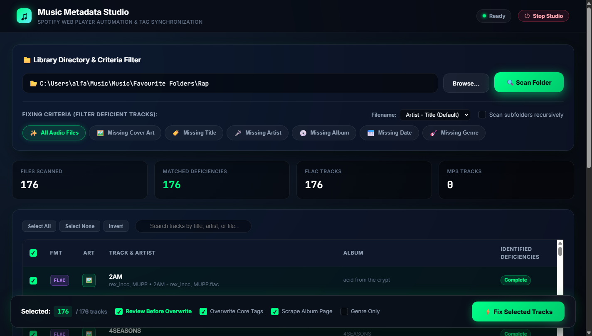
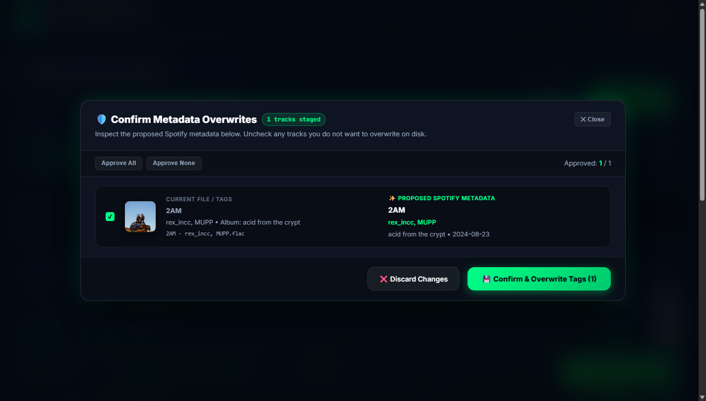

# Music Metadata Studio

A high-performance local audio metadata and cover art synchronization engine for `.flac` and `.mp3` files powered by **Spotify Web Player DOM automation** (`Selenium` + `Chrome`). It bypasses official Spotify Web API credentials, developer tokens, and rate limits completely, functioning with any free Spotify account.

Featuring both a modern **Glassmorphic Web Studio** and an automated **CLI / Subprocess API**, Music Metadata Studio inspects missing tags, searches Spotify in real time, rewrites album artwork to canonical 640x640 resolution, and provides a **mandatory pre-commit confirmation stage** before writing any tags to disk.

---

## Interface Preview

### Main Web Studio Dashboard
Interactive directory browser, health criteria chips (`Missing Cover Art`, `Missing Title`, etc.), filename parse mode selector, and real-time SSE progress telemetry.

<p align="center">
  
</p>

### Pre-Commit Metadata Review & Approval Modal
Inspect side-by-side diffs (original tags vs. canonical Spotify tags) and 640x640 front cover previews. Approve or exclude specific tracks before committing changes to disk.

<p align="center">
  
</p>

---

## Key Capabilities

- **Zero-API Spotify Web Scraping (`SpotifyWebScraper`)**:
  - Operates via persistent Chrome user profile (`data/spotify_chrome_profile/`) and cookies (`data/spotify_cookies.json`). Login once with any free Spotify account.
  - Extracts track candidates from `open.spotify.com/search/.../tracks` in a single JavaScript DOM round-trip.
  - Automatically upgrades `64x64` search thumbnails (`ab67616d00004851`) to **`640x640` full-resolution JPEG cover art** (`ab67616d0000b273`) via Spotify CDN hash rewriting.
  - Scrapes `/album/{id}` (with in-memory per-album caching) to extract full release dates (`YYYY-MM-DD`) and track numbers.
  - Genre resolution powered by `data/genre_cache.json` and configurable genre priority tables.
  - **Bidirectional Title-Artist Heuristics**: Intelligently scores candidates even when files are named `Title - Artist` instead of `Artist - Title`.

- **Pre-Commit Confirmation & Staging**:
  - **Web Studio**: When *Review Before Overwrite* is enabled (default), matches are staged in RAM. The visual review modal displays original vs. proposed tags and artwork previews with per-track approval toggles. Unapproved files remain untouched.
  - **CLI**: Interactive summary confirmation prompt (`--confirm`) displays planned mutations before Stage 3 begins. Use `-y` / `--yes` for automated headless scripts.

- **Modern Glassmorphic Web Studio (`ui_server.py`)**:
  - Fast single-page application served locally via FastAPI and Uvicorn.
  - Deficiency filter chips: filter tracks by `Missing Cover Art`, `Missing Title`, `Missing Artist`, `Missing Album`, `Missing Date`, or `Missing Genre`.
  - Windows native directory picker integration.
  - Real-time Server-Sent Events (SSE) log console and live progress bars.
  - Dedicated one-click **Stop Studio** button to safely kill background server processes.

- **Unified Programmatic API & CLI Interface (`api.py`)**:
  - `MusicMetadataStudio` Python class for clean programmatic usage.
  - JSON-ready CLI commands (`scan`, `inspect`, `sync --json`) designed for subprocessing from external orchestrators (Python, Node.js, Electron, Go).

- **Safe Atomic File Staging**:
  - Copy-on-write tagging using temporary files (`tempfile.mkstemp`).
  - Original files are safely moved to the OS Recycle Bin via `send2trash` (no destructive unrecoverable deletes).

---

## Quick Start (Windows)

### 1. Automated Setup
Double-click [`setup.bat`](setup.bat) or run in PowerShell:
```cmd
setup.bat
```
This script creates a Python virtual environment (`.venv`), upgrades `pip`, and installs all dependencies from `requirements.txt`.

### 2. Launching the Web Studio
Double-click [`run_ui.bat`](run_ui.bat) or run:
```cmd
run_ui.bat
```
The server will start at `http://127.0.0.1:8484` and open automatically in your default browser.

---

## Manual Installation

```bash
# Clone the repository
git clone https://github.com/your-username/Music-Metadata-Handler.git
cd Music-Metadata-Handler

# Create and activate virtual environment
python -m venv .venv
source .venv/bin/activate  # On Windows: .venv\Scripts\activate

# Install dependencies
pip install -r requirements.txt
```

---

## Configuration & First-Time Login

### 1. Default Library Path
The application defaults to `C:/` out of the box. You can customize the default music path by creating `credentials.json` from the provided template:

```bash
cp credentials.example.json credentials.json
```

```json
{
  "music_path": "C:/"
}
```

> **Security Note**: `credentials.json`, `data/spotify_chrome_profile/`, and session cookies are strictly excluded by `.gitignore` to prevent leaking private paths or authentication tokens.

### 2. First-Time Spotify Session
On your very first run, Chrome will launch `https://open.spotify.com`. Log in once with your Spotify account (free tier works completely fine). Your session cookies are cached locally in `data/spotify_chrome_profile` and `data/spotify_cookies.json` for all future automated runs.

---

## Web Studio Guide

1. **Select Library**: Type your music folder path (default: `C:/`) or click **Browse...** to pick a folder.
2. **Filter Deficiencies**: Click criteria chips (`Missing Cover Art`, `Missing Title`, etc.) to isolate tracks requiring repair.
3. **Parse Mode**: Choose between `Artist - Title (Default)` or `Title - Artist` if your files use inverted naming conventions.
4. **Scan**: Click **Scan Folder** to audit tags and cover art across your tracks.
5. **Fix & Review**:
   - Select tracks to repair.
   - Keep **Review Before Overwrite** checked (default).
   - Click **⚡ Fix Selected Tracks**.
   - Review proposed Spotify tags and album art in the confirmation modal.
   - Click **💾 Confirm & Overwrite Tags** to apply changes, or **❌ Discard Changes** to cancel.
6. **Graceful Shutdown**: Click **Stop Studio** in the top navigation bar to terminate the background server process.

---

## CLI Usage (`main.py`)

Run batch repairs directly from your terminal:

```bash
# Run with interactive pre-commit confirmation prompt
python main.py --input-path "C:/Music" --confirm

# Headless batch repair (auto-confirm)
python main.py --input-path "C:/Music" -y --recursive

# Limit to the 25 newest files with Title - Artist format
python main.py --input-path "C:/Music" --process-top-x 25 --filename-mode 1 -y
```

### CLI Flag Reference
| Flag | Description | Default |
| :--- | :--- | :--- |
| `--input-path PATH` | Target folder containing `.flac` and `.mp3` files | `credentials.json` or `C:/` |
| `--output-path PATH` | Destination directory (preserves hierarchy) | In-place overwrite |
| `--confirm` | Require interactive terminal confirmation before disk writes | `False` |
| `-y`, `--yes` | Automatically approve and commit tag mutations | `False` |
| `--recursive` | Recursively scan nested subdirectories | `False` |
| `--process-top-x N` | Process only the $N$ most recently created tracks (`0` = all) | `0` |
| `--filename-mode MODE` | `0` for `Artist - Title`, `1` for `Title - Artist` | `0` |
| `--overwrite-taa` | Overwrite existing Title, Artist, and Album tags | `True` |
| `--update-only-genre` | Restrict updates strictly to the Genre tag | `False` |
| `--scrape-album-details` | Scrape `/album/{id}` for release date and track numbers | `True` |

---

## Programmatic Python API & Subprocess Interface (`api.py`)

`api.py` provides a unified interface for programmatic interaction and external process integration.

### 1. Direct Python Scripting

```python
from pathlib import Path
from api import MusicMetadataStudio

# Initialize Studio instance
studio = MusicMetadataStudio(base_dir=Path("C:/Music"))

# 1. Audit a directory for deficient tracks
scan_report = studio.scan(
    folder_path=Path("C:/Music/Rap"),
    criteria=["lack_cover", "lack_genre"],
    recursive=False
)
print(f"Deficient tracks found: {scan_report['total_matched']}")

# 2. Inspect a single audio file
info = studio.inspect_file(Path("C:/Music/Rap/track.flac"))
print(f"Current tags: {info.title} by {info.artist} (Cover: {info.has_cover})")

# 3. Stage and preview Spotify metadata without touching disk (Dry-Run)
diff = studio.resolve_file(
    Path("C:/Music/Rap/track.flac"),
    filename_parse_mode=1,  # 0: Artist - Title, 1: Title - Artist
    scrape_album=True
)

if diff:
    print(f"Spotify Title: {diff.proposed_title}")
    print(f"Spotify Artist: {diff.proposed_artist}")
    print(f"Spotify Album: {diff.proposed_album} ({diff.proposed_date})")
    print(f"Spotify Cover: {diff.proposed_image_url}")

    # 4. Commit approved diff atomically to file
    studio.commit_diff(diff)
    print("Tags and artwork committed to disk!")
```

---

### 2. Subprocess Integration (CLI JSON Output)

`api.py` can be executed as a standalone CLI tool returning structured JSON payloads on standard output, making it easy to invoke from Python `subprocess`, Node.js child processes, or external scripts.

#### Command Reference

- **Scan Directory (`api scan`)**:
  ```bash
  python api.py scan "C:/Music/Rap" --criteria lack_cover lack_title --json
  ```
  *Output:*
  ```json
  {
    "success": true,
    "total_scanned": 176,
    "total_matched": 1,
    "flac_count": 176,
    "mp3_count": 0,
    "tracks": [
      {
        "filename": "Cash Flick⟡ - Slevpy808.flac",
        "has_cover": false,
        "issues": ["lack_cover"],
        "ext": ".flac"
      }
    ]
  }
  ```

- **Inspect File (`api inspect`)**:
  ```bash
  python api.py inspect "C:/Music/Rap/track.flac" --json
  ```

- **Dry-Run Resolve & Sync (`api sync`)**:
  ```bash
  # Dry-run: inspect proposed changes without modifying disk
  python api.py sync "C:/Music/Rap/track.flac" --filename-mode 1 --dry-run --json

  # Apply tag updates and embed cover art
  python api.py sync "C:/Music/Rap/track.flac" --filename-mode 1 --json
  ```

#### Calling via Python `subprocess`
```python
import json
import subprocess
import sys

def stage_track(file_path: str) -> dict:
    cmd = [
        sys.executable, "api.py", "sync",
        file_path,
        "--dry-run",
        "--json"
    ]
    proc = subprocess.run(cmd, capture_output=True, text=True, check=True)
    return json.loads(proc.stdout)

result = stage_track("C:/Music/Rap/Cash Flick⟡ - Slevpy808.flac")
if result.get("success") and result.get("diff"):
    print("Proposed Metadata:", result["diff"]["proposed"])
```

---

## Architecture Overview

| Module | Description |
| :--- | :--- |
| [`ui_server.py`](ui_server.py) | FastAPI application providing REST endpoints, SSE telemetry, staging queues, and pre-commit commit/discard handlers. |
| [`templates/index.html`](templates/index.html) | Glassmorphic frontend interface with interactive filter chips, live table rendering, and review confirmation modal. |
| [`api.py`](api.py) | Unified programmatic Python API class (`MusicMetadataStudio`) and JSON CLI entrypoint for subprocess integrations. |
| [`main.py`](main.py) | Batch CLI engine supporting multi-track processing, interactive `--confirm` prompts, and filter flags. |
| [`config.py`](config.py) | Central configuration constants, default paths (`C:/`), genre priority lists, and immutable `RuntimeConfig` builders. |
| [`modules/scanner.py`](modules/scanner.py) | Concurrent Mutagen reader for library audits, tag extraction, and deficiency classification (`lack_*`). |
| [`modules/spotify_client.py`](modules/spotify_client.py) | Selenium Chrome driver controller, single-roundtrip DOM track extraction, 640x640 CDN hash rewrite, and album scraping. |
| [`modules/processor.py`](modules/processor.py) | 3-stage execution pipeline (Local tag extraction $\to$ Spotify scraping $\to$ Staged commit). |
| [`modules/tag_utils.py`](modules/tag_utils.py) | Mutagen FLAC Vorbis picture block and MP3 ID3v2.4 APIC frame reader/writer. |
| [`modules/filename_utils.py`](modules/filename_utils.py) | Heuristic artist/title parsing, safe atomic temporary file creation, and Recycle Bin backup. |
| [`modules/search_utils.py`](modules/search_utils.py) | Text normalization, remix token extraction, query sanitation, and character cleaning. |

---

## Security & Privacy

- **No Hardcoded Credentials**: API tokens, personal paths, and passwords are never stored in version control.
- **Protected Session Data**: The `.gitignore` file strictly excludes:
  - `credentials.json` (Template provided via `credentials.example.json`)
  - `data/spotify_chrome_profile/` (Browser storage)
  - `data/spotify_cookies.json` (Session cookies)
  - `*.log`, `*.tmp`, and temporary download artifacts
- **Non-Destructive Overwrites**: Original files are moved to the OS Recycle Bin before staged replacements are committed.

---

## License
This project is licensed under the MIT License. See `LICENSE` for details.
