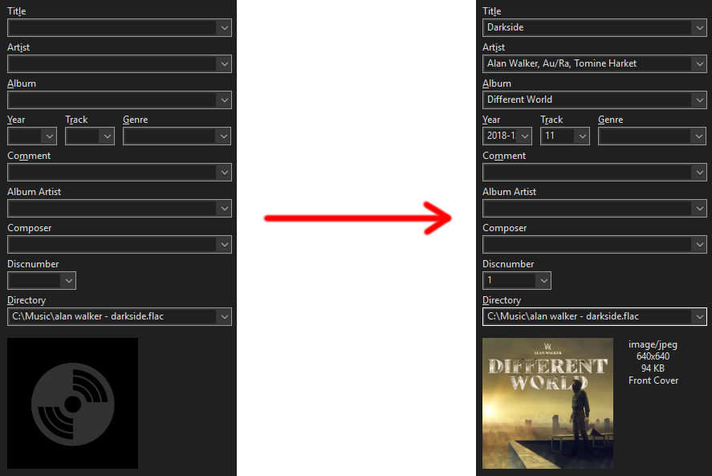

# Music Metadata Handler

A high-performance command-line tool designed to synchronize local audio metadata (FLAC, MP3) with the Spotify Web API. It automatically updates titles, artists, albums, release dates, and high-resolution cover art.

- **CLI Entrypoint**: `main.py` for batch processing and automated library maintenance.
- **Architectural Design**: Decoupled modules for search heuristics, tag I/O, and filename inference.

<p align="center">
  
  <br />
  <sub><i>Experience seamless library organization with embedded artwork and standardized tags.</i></sub>
</p>

## Features
- **Native Support**: Full metadata and cover art support for FLAC and MP3 (ID3v2.4).
- **Intelligent Inference**: Extracts artist/track information from filenames when tags are absent or malformed.
- **Heuristic Search**: Prioritizes ISRC matches before falling back to token-based similarity scoring (remix and feature detection included).
- **Safe Mode**: Optionally update only the genre field to preserve custom library tagging.
- **Ordered Processing**: Optimizes library scanning by processing files based on creation time.

## Installation

1. Initialize a virtual environment (Windows recommended):
```powershell
python -m venv venv
venv\Scripts\Activate.ps1
```

2. Install core dependencies:
```powershell
pip install -r requirements.txt
```

## Configuration & Authentication

The tool requires a `credentials.json` file in the root directory. Unlike legacy versions, this tool uses a direct **Spotify Bearer Token** for maximum simplicity.

### `credentials.json`
```json
{
  "token": "YOUR_SPOTIFY_BEARER_TOKEN",
  "music_path": "C:/path/to/your/music"
}
```

> [!TIP]
> If the token in `credentials.json` is missing or expired, the script will automatically prompt you to paste a new one and update the file for you.

### Key Flags (`config.py`)
- `RECURSIVE`: Scan subdirectories depth-first.
- `PROCESS_TOP_X`: Limit processing volume for large libraries.
- `OVERWRITE_TITLE_ARTIST_OR_ALBUM`: Toggle between forced updates and "fill-in-missing" mode.
- `UPDATE_ONLY_GENRE`: Restricts all updates to the genre field only.

## CLI Usage

Standard execution via the Python interpreter:
```bash
python main.py --input-path "C:/Music" --process-top-x 50 --recursive
```

### Argument Reference
- `--input-path`: Overrides the default source path in `credentials.json`.
- `--process-top-x`: Defines the processing ceiling for the current run.
- `--recursive`: Enables deep-scanning of the library tree.
- `--overwrite-taa`: Forces an overwrite of core metadata fields.

## Module Architecture
- `modules/processor.py`: Orchestrates the per-file validation and update lifecycle.
- `modules/spotify_client.py`: High-level wrapper for Spotify search and matching heuristics.
- `modules/tag_utils.py`: Format-specific I/O for FLAC/MP3 and image processing.
- `modules/filename_utils.py`: Utility functions for temporary staging and path management.
- `modules/search_utils.py`: Normalization and tokenization logic for search queries.
- `modules/core.py`: File system iteration and creation-time sorting.

## Troubleshooting
- **401 Unauthorized**: Ensure your token is fresh. The script will prompt for a new one if it detects expiration.
- **No Matches Found**: Check if your filenames accurately reflect the artist and title. Enable `PRINT_SEARCH_INFO` in `config.py` for a detailed look at the search queries.
- **Recycle Bin**: The script sends original files to the system trash before replacing them. You can restore originals from there if a match is unsatisfactory.

## License
Refer to `LICENSE` for distribution rights and usage constraints.
